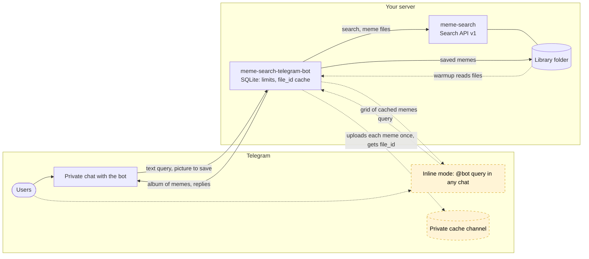

# meme-search-telegram-bot

A Telegram bot for [meme-search](https://github.com/meme-search/meme-search), the self-hosted meme search engine.

- **Search from Telegram.** Send the bot any text and it answers with an album of matching memes, with a
  "More" button to page through up to 20 results (up to 220 on newer meme-search versions).
- **Search settings.** `/settings` switches between "Smart" (by meaning) and "Words" (by the words of the query)
  search and limits it to tags.
- **Inline mode.** Type `@yourbot cat` in any chat, pick a meme from the grid, and it is sent there.
- **Save memes.** Allowed users send or forward a picture to the bot, and it lands in your meme-search library.
- **Limits.** Trusted users search without limits; everyone else gets a small daily quota.
- **English and Russian.** The bot answers in the user's Telegram language, English by default.

The bot talks to meme-search only through its read-only
[Search API v1](https://github.com/meme-search/meme-search/blob/main/docs/search-api.md). Saving works by writing
files into a folder meme-search indexes, so for saving the bot must run on the same machine as meme-search.

## Contents

- [How it works](#how-it-works)
  - [Why a cache channel](#why-a-cache-channel)
- [Setup](#setup)
  - [1. Create the bot](#1-create-the-bot)
  - [2. Create a meme-search API token](#2-create-a-meme-search-api-token)
  - [3. Create the cache channel (for inline mode)](#3-create-the-cache-channel-for-inline-mode)
  - [4. Find user ids](#4-find-user-ids)
  - [5. Prepare the library folder](#5-prepare-the-library-folder)
  - [6. Run it](#6-run-it)
- [Usage](#usage)
  - [Group scope](#group-scope)
- [Configuration](#configuration)
  - [Limits](#limits)
- [Troubleshooting](#troubleshooting)
- [Embedding the modules in another bot](#embedding-the-modules-in-another-bot)
- [Development](#development)
- [License](#license)

## How it works



Dashed yellow parts are optional: inline mode and warmup need the private cache channel (`CACHE_CHAT_ID`).

- **Search in a private chat.** The user sends text, the bot checks the user's daily limit, asks meme-search
  for up to 20 memes and sends the first page as an album with a "More" button.
- **Inline search.** The user types `@yourbot cat` in any chat; the bot answers with memes Telegram already
  has (see below) and queues the rest for upload to the cache channel.
- **Saving.** An allowed user sends a picture; the bot writes it into the library folder, and meme-search
  indexes it from there. That is why saving needs the bot on the same machine as meme-search.

### Why a cache channel

Telegram can send a photo in two ways: upload the bytes, or reuse the `file_id` of a file it already stores.
Inline results accept only a `file_id` (or a public URL, and meme-search media is not public and should not be).
So the bot needs every meme to exist on Telegram's side before it can offer it inline.

The bot keeps a **private channel** for that. When inline search needs a meme Telegram does not have yet, the bot
uploads it to that channel once and stores the returned `file_id` in its SQLite database. Albums in a private
chat do not wait for the channel: they carry the bytes (read from the library folder when possible) and the
bot keeps the `file_id`s Telegram returns. Every later send, inline or in a private chat, reuses the `file_id`:
no download from meme-search, no upload, and it is fast.

To make inline search complete from day one, the bot also **warms the cache**: it scans the library folder,
hashes every image (SHA-256), and uploads the files that have no `file_id` yet, slowly, in the background.
Newest memes go first, by the first `YYYY-MM-DD` date in the file name (file times are useless once files get
copied); files without a date go last. Renaming or moving library folders is safe: the next scan rehashes the
files and reuses the uploads of identical content, nothing is sent to Telegram again.
Search results from the API carry the file name, which is how the bot matches them to local files; when two
folders contain the same file name, the bot downloads that one meme from the API and picks the file whose
SHA-256 matches.

All uploads to the channel share one queue. Inline misses go to the front of the queue, before any warmup
upload, and warmup is additionally capped at `WARMUP_UPLOADS_PER_MIN`. When you keep typing, uploads for
your earlier queries drop behind the current one (still ahead of warmup). Telegram throttles bots that
post to one chat too fast (roughly 20 messages per minute), so the first full warmup of a large library takes
hours. The bot is fully usable meanwhile; memes not uploaded yet just show up in inline results a query later.
While some results of an inline query are still uploading, the grid shows a "Memes are loading, try again in a few
seconds" button above it; tapping it opens the bot's private chat with a plain `/start`.

Without `CACHE_CHAT_ID` private chat search works the same way, but inline mode and warmup are off.

## Setup

### 1. Create the bot

1. Open [@BotFather](https://t.me/BotFather), send `/newbot`, pick a name and a username. Keep the token: it is
   `TELEGRAM_BOT_TOKEN`.
2. For inline mode: `/setinline`, choose the bot, and enter a placeholder such as `Search memes...`.

### 2. Create a meme-search API token

In meme-search open **Settings -> API tokens**, create a token named e.g. `telegram-bot` with the scopes
`search:read` and `media:read`. Copy it right away (it is shown once): it is `MEME_SEARCH_API_TOKEN`. On newer
meme-search versions you may also tick `media:write`, which lets the bot upload memes through API v2; without it
the bot logs once per check that uploads are off.

### 3. Create the cache channel (for inline mode)

1. In Telegram create a new **private** channel, e.g. "memebot cache". Nobody else needs to join it.
2. Add your bot to the channel as an **administrator** with permission to post messages.
3. Get the channel id. Either forward any message from the channel to [@userinfobot](https://t.me/userinfobot),
   or open the channel in [Telegram Web](https://web.telegram.org/a/): the URL ends with `#-100...`. The id looks
   like `-1001234567890` and is `CACHE_CHAT_ID`.

The bot posts every meme into this channel once. Do not delete those posts while the bot uses them.

### 4. Find user ids

Telegram user ids are numbers. Send any message to [@userinfobot](https://t.me/userinfobot) to see yours, and ask
people you want to allow to do the same.

- `SAVE_USER_IDS`: who may save memes (they also search without limits).
- `TRUSTED_USER_IDS`: who may search without limits.
- `ADMIN_CONTACT`: what people over the limit see, e.g. `@your_username`.

### 5. Prepare the library folder

The bot reads the library (for warmup) and writes saved memes into it. Point `/memes` (Docker) or `SAVE_DIR` at
the **same host folder** that meme-search mounts as `/rails/public/memes` (and the description generator as
`/app/public/memes`). In the stock meme-search compose file that is `./meme_search/memes/`.

By default (`SAVE_MODE=per_user`) the bot saves each user's memes into a flat subfolder
`<SAVE_DIR_PREFIX><username>`, e.g. `tg-alice/`. With `SAVE_MODE=single` everybody's memes go into one subfolder,
`SAVE_FOLDER` (default `telegram/`), and a meme two users send is saved once. Files are named
`2026-10-18_<source>_<message id>_<hash>.jpg`, where the source is the channel or person the meme was forwarded
from and the hash is the first 20 hex chars of the file's SHA-256.
meme-search does not pick up new folders by itself, and it serves images only from flat folders: register the
folder in meme-search **Settings -> Image paths** by its bare name. In single mode that is one folder
(`telegram`), registered once; in per_user mode it is one per user (`tg-alice`), after they saved the first meme.

With `SAVE_MODE=nested` each user gets a subfolder of `SAVE_FOLDER`, e.g. `telegram/alice/` (no
`SAVE_DIR_PREFIX`). Register `telegram` once with "include subfolders": every new user's folder is then picked
up on the next scan of the parent. This option exists only in meme-search builds that have it (not in stock
meme-search). Switching an existing setup to nested mode does not move old `tg-*` folders; they stay registered
as they are.
New files in a registered folder are indexed on the next rescan and become searchable once their
description is generated.
With `SAVE_BACKEND=api` the bot uploads saved memes through meme-search's upload API (the
`MEME_SEARCH_API_TOKEN` then needs the `media:write` scope too) and asks for the description right away, so no rescan
is needed. The API fills only folders registered in meme-search: an unregistered save folder, or a server
without the upload API, makes the bot write the file as usual. Without a shared volume, use `SAVE_MODE=single`
with a registered `SAVE_FOLDER`.
If meme-search has the meme listing (`GET /api/v1/memes`), the bot follows its change feed to warm up new
memes within `FEED_INTERVAL`, and without `LIBRARY_DIR` straight from the API.

Files are written as uid 1000 (the image's default, the same as meme-search's upload folder). If your folder
belongs to another uid, rebuild the image with `--build-arg APP_UID=<uid>`.

### 6. Run it

**Next to meme-search (recommended).** From the meme-search directory:

```sh
cp /path/to/meme-search-telegram-bot/docker-compose.meme-search.yml .
cp /path/to/meme-search-telegram-bot/.env.example .env.telegram-bot   # then fill it in
docker compose -f docker-compose.yml -f docker-compose.meme-search.yml up -d
```

The bot reads `.env.telegram-bot`, not `.env`, which meme-search uses for itself. It joins the
meme-search compose network and talks to `http://meme_search:3000` directly, so `MEME_SEARCH_URL` is set for you.
Its SQLite database lives in `./meme_search/telegram-bot/`.

**Standalone,** pointing at an existing instance:

```sh
mkdir meme-bot && cd meme-bot
curl -O https://raw.githubusercontent.com/GRbit/meme-search-telegram-bot/main/docker-compose.yml
curl -o .env https://raw.githubusercontent.com/GRbit/meme-search-telegram-bot/main/.env.example
# edit .env, and the ./memes volume in docker-compose.yml
docker compose up -d
```

**Without Docker:** `make build` and run `bin/meme-search-telegram-bot` with the variables in the environment.
Relative defaults (`data/bot.db`, `memes/`, `config.yml`) are resolved next to the binary.

Then open the bot in Telegram and send `/start`.

## Usage

- Send any text in the private chat to search; "More" pages through up to 20 results. Newer meme-search versions
  page further (up to 220): past the first 20 the bot fetches the next 20, and "Page 4 of 4+" says more exist.
- `/settings` sets your own search mode and tags, kept until you change them:
  - **Smart** (vector search, the default) finds memes by meaning, also across languages.
  - **Words** (keyword search) finds memes containing any word of the query; memes matching more words come
    first.
  - **Tags** limit search to memes having any of the given tags (at most 10, as meme-search allows). Type them
    separated by commas, or, when meme-search can list its tags (newer versions), "Pick tags" from the list. With
    two or more tags and a meme-search that supports it, "All tags" finds only memes having every one of them.
  - **Folders** (only when meme-search can list its folders, newer versions) limit search to the chosen library
    folders, at most 10; "Only mine" picks your own save folder, "All folders" drops the limit.
  - **Reset** returns to the defaults. Changing settings never counts against the daily limit.
- Filters typed into one search replace the saved value of their kind for that search only:
  - `#tag` (repeatable) searches only memes with any of these tags, e.g. `#cat #dog funny`.
  - `dir:folder` (repeatable, case does not matter) searches only those folders; `dir:*` ignores the saved
    folders. A meme-search version without the folder filter searches all folders, and the bot says so.
  - Words starting with `#` inside a word (`c#`) stay part of the query. A message with filters only is not a
    search and does not count.
- When a search is not the default one, the message under the results says what applied (e.g. "Search: Words,
  tags: cat"); with tags there is a "Search everywhere" button that repeats the search without them (it counts as
  a search). Applied folders behave like tags. An empty result with tags says so and offers the same button.
- "Similar N" under the results searches for memes similar to the N-th meme of that album; it counts as a
  search. Newer meme-search versions compare the meme itself; otherwise, and within tags or folders, the bot
  searches by its description, within the same tags and folders. Memes not described yet have no such button.
- Inline (`@yourbot query` in any chat) always uses Smart search. Its tags and folders come, each on its own, most specific first, from
  `#tag` in the query, a group's scope button (below), the user's `/settings`, and for queries typed in groups the
  `INLINE_GROUP_SCOPE` default.

### Group scope

Telegram does not tell a bot which group an inline query is typed in, so a group's meme scope travels in the
query. Add the bot to the group (no admin rights and no privacy mode change needed), then a group admin sends:

- `/memescope@yourbot set #reaction #work` (filters only: `#tag`, `dir:folder`). The bot answers with a message
  whose "Search memes" button types `@yourbot g:<code> ` into the input field; pin that message.
- `/memescope@yourbot` shows the scope (anyone), `reset` searches all memes but keeps the button working,
  `button` posts the button again, `off` removes the scope.

Queries with that code search within the group's tags; typing `@yourbot` by hand uses your own settings. The
code is not a secret: anyone typing it only changes their own results. Limits are unchanged: whoever types the
query pays for it. Removing the bot from the group deletes its scope.

#### Scope filter syntax

`/memescope set` and the `INLINE_GROUP_SCOPE` setting take the same filters as a search message, without the
search words:

- Filters are separated by spaces; each word is one filter.
- `#tag` is one tag, repeatable, at most 10 tags of at most 20 characters each. A meme matches any of them. A
  trailing `,` or `;` is dropped, so `#cat, #dog` is two tags, but `#cat,#dog` is the single tag `cat,#dog`. Tags
  containing spaces cannot be written here.
- `dir:folder` is one library folder (the prefix may be written in any case), repeatable, at most 10. Folder names
  containing spaces are not supported. `/memescope set` checks the names against meme-search's folder list when
  meme-search can list folders: case does not matter and unknown names are refused. `INLINE_GROUP_SCOPE` uses the
  names as written, so they must match meme-search exactly, case included.
- `dir:*` (ignore saved folders) is meant for a single search and does nothing here; `/memescope set dir:*` alone
  is refused as having no filter.
- Any other word is an error: `/memescope set` saves nothing and answers with the filter format, and an `INLINE_GROUP_SCOPE`
  with words in it stops the bot at startup with a configuration error.

Example: `/memescope@yourbot set #reaction #work dir:work/reactions`, or `INLINE_GROUP_SCOPE="#reaction #work"`.
In YAML and `.env` files keep the value in quotes: `#` can start a comment there.

## Configuration

Settings come from built-in defaults, then an optional YAML file (`CONFIG_FILE`, see
[config.example.yml](config.example.yml)), then environment variables, each overriding the previous one. Empty
environment variables count as unset. Durations use Go syntax (`10s`, `5m`, `6h`).
[.env.example](.env.example) explains every variable in detail.

| Variable | Default | Meaning |
|---|---|---|
| `TELEGRAM_BOT_TOKEN` | required | Bot token from @BotFather |
| `MEME_SEARCH_URL` | required | Base URL of meme-search, e.g. `http://meme_search:3000` |
| `MEME_SEARCH_API_TOKEN` | required | API token with `search:read,media:read`; add `media:write` to allow uploads (newer meme-search only) |
| `MEME_SEARCH_TIMEOUT` | `30s` | Timeout of one API request |
| `RESULTS_PER_PAGE` | `5` | Memes per page in private chat, 1-10 |
| `SEARCH_MODE` | `vector` | `vector` (semantic) or `keyword` |
| `INLINE_RESULTS` | `3` | Memes per inline query, 1-20; uncached ones are queued for upload |
| `INLINE_GROUP_SCOPE` | empty | Default `#tag`/`dir:` filters of inline queries typed in groups, see [Scope filter syntax](#scope-filter-syntax) |
| `INLINE_DEBOUNCE` | `1s` | Inline queries wait this long and are dropped if the user kept typing; at most `5s`, `0` disables |
| `CACHE_CHAT_ID` | empty | Private cache channel id; empty disables inline mode and warmup |
| `LIBRARY_DIR` | `SAVE_DIR` | Library root scanned for warmup and file name matching |
| `WARMUP_INTERVAL` | `6h` | How often the library is rescanned |
| `FEED_INTERVAL` | `1m` | How often the change feed is polled (servers with the meme listing only) |
| `CACHE_UPLOADS_PER_MIN` | `20` | All uploads to the cache channel per minute |
| `WARMUP_UPLOADS_PER_MIN` | `10` | Background warmup uploads per minute, at most the value above |
| `SAVE_DIR` | `memes/` next to the binary, `/memes` in Docker | Where saved memes go |
| `SAVE_MODE` | `per_user` | `per_user`: a folder per user; `single`: one folder for everybody; `nested`: `SAVE_FOLDER/<username>` |
| `SAVE_FOLDER` | `telegram` | The folder of `single` mode, the parent of `nested` mode; letters, digits, `-`, `_` |
| `SAVE_DIR_PREFIX` | `tg-` | Prefix of per-user save folders (`per_user` mode) |
| `SAVE_NOTE` | empty | Text added to the "Saved" reply |
| `SAVE_BACKEND` | `folder` | `folder`: write files; `api`: upload through meme-search's API (API token needs `media:write`), files as fallback |
| `SAVE_USER_IDS` | empty | User ids allowed to save; empty disables saving |
| `TRUSTED_USER_IDS` | empty | User ids with unlimited search |
| `PUBLIC_DAILY_PER_USER` | `5` | Searches per day for everyone else; `0` disables public search |
| `PUBLIC_DAILY_TOTAL` | `120` | Searches per day for all public users together; `0` disables public search |
| `INLINE_CHARGE_WINDOW` | `10s` | Inline queries of one user within this window count as one search |
| `ADMIN_CONTACT` | empty | Shown in the limit message, e.g. `@your_username` |
| `DEFAULT_LANG` | `en` | Fallback language: users get their Telegram language if the bot has it (`en`, `ru`), otherwise this one |
| `TZ` | `UTC` | Time zone of the daily limit reset and of dates in file names |
| `DB_PATH` | `data/bot.db` next to the binary, `/data/bot.db` in Docker | SQLite database |
| `CONFIG_FILE` | `config.yml` next to the binary, `/config/config.yml` in Docker | Optional YAML config (an alternative to environment variables; they override it) |
| `LOG_LEVEL` | `info` | `debug` logs every API call and user interaction (no tokens) |

### Limits

Every text search and inline search by a public user counts as one search; paging
with "More" is free, it reuses results the bot already has (or, past the first 20 on newer meme-search versions,
continues the same search). Telegram sends an inline query on every keystroke,
so inline queries count once per `INLINE_CHARGE_WINDOW`; queries dropped by `INLINE_DEBOUNCE` count the same way,
they do not cost extra. Counters are stored in SQLite and reset at midnight in
`TZ`. Search API v1 allows 60 requests per minute per token; the limits keep public use well below that.

## Troubleshooting

- **Inline mode shows nothing:** check `/setinline` in BotFather and `CACHE_CHAT_ID`; the startup log says
  whether inline mode is on. Right after the first start the cache is empty: results appear as uploads finish.
- **"Search failed":** run with `LOG_LEVEL=debug`; a `401`/`403` from meme-search means a wrong token or a
  missing scope.
- **Saved memes do not show up:** register the save folder (`tg-<username>`, or `SAVE_FOLDER` in single mode, or `SAVE_FOLDER` with "include
  subfolders" in nested mode)
  in meme-search Settings -> Image paths and wait for descriptions to be generated.
- **Permission denied writing memes or the database:** the mounted folders must be writable by uid 1000 (or the
  `APP_UID` you built with).

## Embedding the modules in another bot

Search, saving, access limits and the media cache are separate Go packages that another
[go-telegram/bot](https://github.com/go-telegram/bot) bot can import. See [docs/embedding.md](docs/embedding.md).

## Development

```sh
make test   # go test -race ./...
make lint   # go vet + golangci-lint
make run    # runs the bot with variables from .env.local
```

Design notes: [GLOSSARY.md](GLOSSARY.md), [docs/adr/](docs/adr/), [docs/plan.md](docs/plan.md).

## License

MIT
