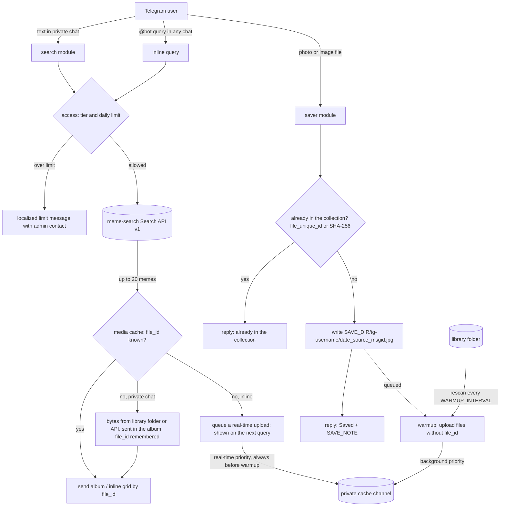

# meme-search-telegram-bot

A Telegram bot for [meme-search](https://github.com/meme-search/meme-search), the self-hosted meme search engine.

- **Search from Telegram.** Send the bot any text and it answers with an album of matching memes, with a
  "More" button to page through up to 20 results.
- **Inline mode.** Type `@yourbot cat` in any chat, pick a meme from the grid, and it is sent there.
- **Save memes.** Allowed users send or forward a picture to the bot, and it lands in your meme-search library.
- **Limits.** Trusted users search without limits; everyone else gets a small daily quota.
- **English and Russian.** The bot answers in the user's Telegram language, English by default.

The bot talks to meme-search only through its read-only
[Search API v1](https://github.com/meme-search/meme-search/blob/main/docs/search-api.md). Saving works by writing
files into a folder meme-search indexes, so for saving the bot must run on the same machine as meme-search.

## How it works



### Why a cache channel

Telegram can send a photo in two ways: upload the bytes, or reuse the `file_id` of a file it already stores.
Inline results accept only a `file_id` (or a public URL, and meme-search media is not public and should not be).
So the bot needs every meme to exist on Telegram's side before it can offer it inline.

The bot keeps a **private channel** for that. When inline search needs a meme Telegram does not have yet, the bot
uploads it to that channel once and stores the returned `file_id` in its SQLite database. Albums in a private
chat do not wait for the channel: they carry the bytes (read from the library folder when possible) and the
bot keeps the `file_id`s Telegram returns. Every later send, inline or in a private chat, reuses the `file_id`:
no download from meme-search, no upload, and it is fast.

To make inline search complete from day one, the bot also **warms the cache**: it scans the library folder,
hashes every image (SHA-256), and uploads the files that have no `file_id` yet, slowly, in the background.
Search results from the API carry the file name, which is how the bot matches them to local files; when two
folders contain the same file name, the bot downloads that one meme from the API and picks the file whose
SHA-256 matches.

All uploads to the channel share one queue. Inline misses go to the front of the queue, before any warmup
upload, and warmup is additionally capped at `WARMUP_UPLOADS_PER_MIN`. Telegram throttles bots that
post to one chat too fast (roughly 20 messages per minute), so the first full warmup of a large library takes
hours. The bot is fully usable meanwhile; memes not uploaded yet just show up in inline results a query later.

Without `CACHE_CHAT_ID` private chat search works the same way, but inline mode and warmup are off.

## Setup

### 1. Create the bot

1. Open [@BotFather](https://t.me/BotFather), send `/newbot`, pick a name and a username. Keep the token: it is
   `TELEGRAM_BOT_TOKEN`.
2. For inline mode: `/setinline`, choose the bot, and enter a placeholder such as `Search memes...`.

### 2. Create a meme-search API token

In meme-search open **Settings -> API tokens**, create a token named e.g. `telegram-bot` with the scopes
`search:read` and `media:read`. Copy it right away (it is shown once): it is `MEME_SEARCH_API_TOKEN`.

### 3. Create the cache channel (for inline mode)

1. In Telegram create a new **private** channel, e.g. "memebot cache". Nobody else needs to join it.
2. Add your bot to the channel as an **administrator** with permission to post messages.
3. Get the channel id. Either forward any message from the channel to [@userinfobot](https://t.me/userinfobot),
   or open the channel in [Telegram Web](https://web.telegram.org/a/): the URL ends with `#-100...`. The id looks
   like `-1001234567890` and is `CACHE_CHAT_ID`.

The bot posts every meme into this channel once. Do not delete those posts while the bot uses them.

### 4. Find user ids

Telegram user ids are numbers. Send any message to [@userinfobot](https://t.me/userinfobot) to see yours, and ask
people you want to allow to do the same.

- `SAVE_USER_IDS`: who may save memes (they also search without limits).
- `TRUSTED_USER_IDS`: who may search without limits.
- `ADMIN_CONTACT`: what people over the limit see, e.g. `@your_username`.

### 5. Prepare the library folder

The bot reads the library (for warmup) and writes saved memes into it. Point `/memes` (Docker) or `SAVE_DIR` at
the **same host folder** that meme-search mounts as `/rails/public/memes` (and the description generator as
`/app/public/memes`). In the stock meme-search compose file that is `./meme_search/memes/`.

The bot saves each user's memes into a flat subfolder `<SAVE_DIR_PREFIX><username>`, e.g. `tg-alice/`, named
`2026-10-18_<source>_<message id>.jpg`, where the source is the channel or person the meme was forwarded from.
meme-search does not pick up new folders by itself, and it serves images only from flat folders: after a user
saved the first meme, register the folder in meme-search **Settings -> Image paths** by its bare name
(`tg-alice`). New files in a registered folder are indexed on the next rescan and become searchable once their
description is generated.

Files are written as uid 1000 (the image's default, the same as meme-search's upload folder). If your folder
belongs to another uid, rebuild the image with `--build-arg APP_UID=<uid>`.

### 6. Run it

**Next to meme-search (recommended).** From the meme-search directory:

```sh
cp /path/to/meme-search-telegram-bot/docker-compose.meme-search.yml .
cp /path/to/meme-search-telegram-bot/.env.example .env.telegram-bot   # then fill it in
docker compose -f docker-compose.yml -f docker-compose.meme-search.yml up -d
```

The bot reads `.env.telegram-bot`, not `.env`, which meme-search uses for itself. It joins the
meme-search compose network and talks to `http://meme_search:3000` directly, so `MEME_SEARCH_URL` is set for you.
Its SQLite database lives in `./meme_search/telegram-bot/`.

**Standalone,** pointing at an existing instance:

```sh
mkdir meme-bot && cd meme-bot
curl -O https://raw.githubusercontent.com/GRbit/meme-search-telegram-bot/main/docker-compose.yml
curl -o .env https://raw.githubusercontent.com/GRbit/meme-search-telegram-bot/main/.env.example
# edit .env, and the ./memes volume in docker-compose.yml
docker compose up -d
```

**Without Docker:** `make build` and run `bin/meme-search-telegram-bot` with the variables in the environment.
Relative defaults (`data/bot.db`, `memes/`, `config.yml`) are resolved next to the binary.

Then open the bot in Telegram and send `/start`.

## Configuration

Settings come from built-in defaults, then an optional YAML file (`CONFIG_FILE`, see
[config.example.yml](config.example.yml)), then environment variables, each overriding the previous one. Empty
environment variables count as unset. Durations use Go syntax (`10s`, `5m`, `6h`).
[.env.example](.env.example) explains every variable in detail.

| Variable | Default | Meaning |
|---|---|---|
| `TELEGRAM_BOT_TOKEN` | required | Bot token from @BotFather |
| `MEME_SEARCH_URL` | required | Base URL of meme-search, e.g. `http://meme_search:3000` |
| `MEME_SEARCH_API_TOKEN` | required | API token with `search:read,media:read` |
| `MEME_SEARCH_TIMEOUT` | `30s` | Timeout of one API request |
| `RESULTS_PER_PAGE` | `5` | Memes per page in private chat, 1-10 |
| `SEARCH_MODE` | `vector` | `vector` (semantic) or `keyword` |
| `CACHE_CHAT_ID` | empty | Private cache channel id; empty disables inline mode and warmup |
| `LIBRARY_DIR` | `SAVE_DIR` | Library root scanned for warmup and file name matching |
| `WARMUP_INTERVAL` | `6h` | How often the library is rescanned |
| `CACHE_UPLOADS_PER_MIN` | `20` | All uploads to the cache channel per minute |
| `WARMUP_UPLOADS_PER_MIN` | `10` | Background warmup uploads per minute, at most the value above |
| `SAVE_DIR` | `memes/` next to the binary, `/memes` in Docker | Where saved memes go |
| `SAVE_DIR_PREFIX` | `tg-` | Prefix of per-user save folders |
| `SAVE_NOTE` | empty | Text added to the "Saved" reply |
| `SAVE_USER_IDS` | empty | User ids allowed to save; empty disables saving |
| `TRUSTED_USER_IDS` | empty | User ids with unlimited search |
| `PUBLIC_DAILY_PER_USER` | `5` | Searches per day for everyone else; `0` disables public search |
| `PUBLIC_DAILY_TOTAL` | `120` | Searches per day for all public users together; `0` disables public search |
| `INLINE_CHARGE_WINDOW` | `10s` | Inline queries of one user within this window count as one search |
| `ADMIN_CONTACT` | empty | Shown in the limit message, e.g. `@your_username` |
| `DEFAULT_LANG` | `en` | Language for users whose Telegram language has no translation |
| `TZ` | `UTC` | Time zone of the daily limit reset and of dates in file names |
| `DB_PATH` | `data/bot.db` next to the binary, `/data/bot.db` in Docker | SQLite database |
| `CONFIG_FILE` | `config.yml` next to the binary, `/config/config.yml` in Docker | Optional YAML config |
| `LOG_LEVEL` | `info` | `debug` logs every API call and user interaction (no tokens) |

### Limits

Every text search and inline search by a public user counts as one search; paging
with "More" is free, it reuses results the bot already has. Telegram sends an inline query on every keystroke,
so inline queries count once per `INLINE_CHARGE_WINDOW`. Counters are stored in SQLite and reset at midnight in
`TZ`. Search API v1 allows 60 requests per minute per token; the limits keep public use well below that.

## Troubleshooting

- **Inline mode shows nothing:** check `/setinline` in BotFather and `CACHE_CHAT_ID`; the startup log says
  whether inline mode is on. Right after the first start the cache is empty: results appear as uploads finish.
- **"Search failed":** run with `LOG_LEVEL=debug`; a `401`/`403` from meme-search means a wrong token or a
  missing scope.
- **Saved memes do not show up:** register the `tg-<username>` folder in meme-search Settings -> Image paths and
  wait for descriptions to be generated.
- **Permission denied writing memes or the database:** the mounted folders must be writable by uid 1000 (or the
  `APP_UID` you built with).

## Embedding the modules in another bot

Search, saving, access limits and the media cache are separate Go packages that another
[go-telegram/bot](https://github.com/go-telegram/bot) bot can import. See [docs/embedding.md](docs/embedding.md).

## Development

```sh
make test   # go test -race ./...
make lint   # go vet + golangci-lint
make run    # runs the bot with variables from .env.local
```

Design notes: [GLOSSARY.md](GLOSSARY.md), [docs/adr/](docs/adr/), [docs/plan.md](docs/plan.md).

## License

MIT
